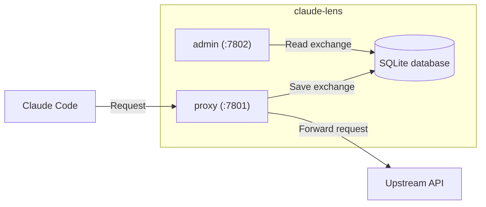

# About

A transparent HTTP proxy that sits between your Claude Code client and an upstream Anthropic API (by default) or another compatible proxy. Every request and response is captured and stored in a local SQLite database, giving you a full audit trail of prompts, completions, token usage, and cost across sessions — with a small admin dashboard to browse it.

`claude-lens` is a single static binary. It runs two HTTP servers concurrently in one process — a reverse proxy and an admin UI — sharing one in-process database connection and health flag.

It will add very little latency to your requests (since requests are buffered and only saved after completion), and is designed to be run locally on your machine. It does not require any external services or cloud infrastructure, and does not send any data to any cloud.

## Installation

### Env configuration

If you use the [install script](#install-script), this is done for you — it writes `ANTHROPIC_BASE_URL` into `~/.claude/settings.json`.

For a [manual install](#manual-install), set it yourself: either the same way (`~/.claude/settings.json`'s `env` block), or by exporting it in your shell:

```sh
export ANTHROPIC_BASE_URL=http://localhost:7801
```

#### Existing proxy

If you have another proxy already in use (e.g. LiteLLM or Bifrost), configure and activate it in the admin UI under **Integrations → Proxy**: base URL, auth token and optional custom headers. With no proxy integration active, requests go directly to the Anthropic API.

### Install script

You can run the install script to download the latest release for your OS and architecture, and setup `claude-lens` as a background service.

Also use it to update an existing installation. It will overwrite the existing binary and merge any new configurations, but preserve your database and logs.

> This means that you can use the install script to update your configurations and/or the binary without losing your data.

You may provide flags to the install script to customize the Envs.

| Flag | Default | Points to Env |
|---|---|---|
| `--proxy-addr` | `7801` | Port of `CLENS_PROXY_ADDR`. |
| `--admin-addr` | `7802` | Port of `CLENS_ADMIN_ADDR`. |
| `--bind` | `127.0.0.1` | Host of `CLENS_PROXY_ADDR` and `CLENS_ADMIN_ADDR`. Anything other than a loopback address exposes the admin UI and the proxy to your network. |
| `--install-dir` | `~/.claude-lens` | Holds the binary, `data/` (`CLENS_DATA_DIR`) and `logs/` (`CLENS_LOG_DIR`). |
| `--as-service` | — | If set, will install as a system service (Linux) or launchd agent (macOS). |

#### Linux

To only install:

```sh
curl -sSL https://raw.githubusercontent.com/lfsc09/claude-lens/main/scripts/install_linux.sh | sudo bash
```

To install and run as a system service:

```sh
curl -sSL https://raw.githubusercontent.com/lfsc09/claude-lens/main/scripts/install_linux.sh | sudo bash -s -- --as-service
```

To provide custom configurations, use flags like:

```sh
curl -sSL https://raw.githubusercontent.com/lfsc09/claude-lens/main/scripts/install_linux.sh | sudo bash -s -- \
  --proxy-addr 7801 \
  --admin-addr 7802 \
  --install-dir ~/.claude-lens \
  --as-service
```

#### MacOS

To only install:

```sh
curl -sSL https://raw.githubusercontent.com/lfsc09/claude-lens/main/scripts/install_macos.sh | bash
```

To install and run as a launchd agent:

```sh
curl -sSL https://raw.githubusercontent.com/lfsc09/claude-lens/main/scripts/install_macos.sh | bash -s -- --as-service
```

### Manual install

You can also download the latest release binary straight from the [releases page](https://github.com/lfsc09/claude-lens/releases), and manually configure the environment variables (see below) to customize behaviour.

```sh
mkdir -p ~/claude-lens
```

```sh
curl -sSL "https://github.com/lfsc09/claude-lens/releases/latest/download/claude-lens-linux-amd64" -o ~/claude-lens/claude-lens-linux-amd64
```

```sh
chmod ug+x ~/claude-lens/claude-lens-linux-amd64
```

```sh
cd ~/claude-lens && ./claude-lens-linux-amd64
```

## Environment variables

All `claude-lens` configuration is via environment variables. They are all optional to customize behaviour.

They all must be set in OS environment. The `.env` file is only read in development builds (see [Getting started](#development-details)).

| Variable | Default | Description |
|---|---|---|
| `CLENS_PROXY_ADDR` | `127.0.0.1:7801` | Proxy server listen address, as `host:port`. |
| `CLENS_ADMIN_ADDR` | `127.0.0.1:7802` | Admin server listen address, as `host:port`. |
| `CLENS_DATA_DIR` | `data` | Where the SQLite database is created. |
| `CLENS_LOG_DIR` | `logs` | Where the rotating log file is written (5MB × 3 backups). |

## Security

`claude-lens` has no authentication and stores your gateway auth token and Slack webhook URLs, so it listens on loopback (`127.0.0.1`) by default.

- The admin server rejects requests whose `Host` is not a loopback name, and state-changing requests from another origin or with a non-JSON body, so a web page you visit cannot drive it. These checks are relaxed only when `CLENS_ADMIN_ADDR` is not a loopback address.
- The proxy rejects requests carrying a browser `Origin` or `Sec-Fetch-Site` header.
- The install directory, `data/`, `logs/` and the database file are only readable by their owner (`0700` / `0600`).
- To listen on other interfaces, pass `--bind HOST` to the installer or set the `CLENS_*_ADDR` variables, and put an authenticating reverse proxy in front.

## Data and Logs

The SQLite database is created in `CLENS_DATA_DIR` (default `data/`) and is named `claude-lens.db`.

Logs are written to `CLENS_LOG_DIR` (default `logs/`) in a rotating file named `claude-lens.log`. It rotates at 5MB and keeps 3 timestamped backups + 1 active log file - capping total log storage at 20MB.

## Easy seeding

You can seed rows into the database using:

```sh
claude-lens --feed --table table_name --row '{"column1":"value1","column2":"value2"}'
```

| CLI flag | Description |
|---|---|
| `--feed` | Enable feeding data into the database |
| `--table` | Specify the table to insert the row into |
| `--row` | JSON string representing the row to insert or update |
| `--match` | JSON string of column:value pairs; if it matches exactly one existing row, `--row` updates it instead of inserting a new one |

### Examples

Add price configuration:

```sh
claude-lens --feed --table model_prices --row '{"model_prefix": "claude-sonnet-5", "input_per_m": 3, "output_per_m": 15, "cache_write_per_m": 4, "cache_read_per_m": 0.2}'
```

Add limiter:

```sh
claude-lens --feed --table limiters --row '{"session_id": "", "limit_amount": 20, "refresh_value": 1, "refresh_unit": "days", "refresh_aligned": true}'
```

Update price if it exists, otherwise create it (`--match` finds the row by `model_prefix`; if more than one row matches, the command fails instead of guessing):

```sh
claude-lens --feed --table model_prices --match '{"model_prefix": "claude-sonnet-5"}' --row '{"model_prefix": "claude-sonnet-5", "input_per_m": 3, "output_per_m": 15, "cache_write_per_m": 4, "cache_read_per_m": 0.2}'
```

Update a proxy integration (`proxy_integrations` rows are seeded by the database, so `--match` is required and the command fails if no row matches; `--match` can use `type` or `name`):

```sh
claude-lens --feed --table proxy_integrations --match '{"type": "litellm"}' --row '{"base_url": "https://litellm.example.com", "auth_token": "sk-...", "price_sync_interval_minutes": 60}'
```

Add or update a notification integration (`--match` can use `type` or `name`; secrets like `webhook_url` are masked by the API, so they cannot be matched on):

```sh
claude-lens --feed --table notification_integrations --match '{"name": "Team Slack"}' --row '{"name": "Team Slack", "type": "slack", "webhook_url": "https://hooks.slack.com/services/..."}'
```

`--row` must still be the full row on a match — any field it omits that the table accepts is reset to its default (e.g. an omitted `cache_read_per_m` becomes `0`, an omitted `*_above_200k` becomes unset), not left as its current value.

## Dummy data

You can generate dummy exchanges for development, through the running service:

```sh
claude-lens --dummy --count 200 --sessions 6
```

| CLI flag | Description |
|---|---|
| `--dummy` | Create dummy exchanges instead of starting the service |
| `--count` | Number of exchanges to create (default `100`) |
| `--sessions` | Number of distinct sessions to spread them over (default `5`) |

Creation times are spread over the last 30 days. `--dummy` cannot be combined with `--feed`.

## Slack alerts

A limiter linked to one or more active Slack notification integrations (**Integrations → Notifications** in the admin UI) gets notified when it crosses the `threshold_pct` or `request_cost_usd` set on each link. Every notification is a Slack [incoming webhook](https://api.slack.com/messaging/webhooks) POST with the same minimal JSON structure — a single `text` field, no blocks or attachments:

```json
{
  "text": "<message>"
}
```

| Trigger | Message format | Example |
|---|---|---|
| Limiter's accumulated cost crosses `threshold_pct` of its budget | `:warning: claude-lens: <scope> limiter has spent $<current> of its $<budget> budget (<pct>% threshold reached)` | `:warning: claude-lens: global limiter has spent $16.00 of its $20.00 budget (80% threshold reached)` |
| A single exchange's cost meets or exceeds `request_cost_usd` | `:rotating_light: claude-lens: a single request cost $<cost> (<model>, <scope>) — over the $<threshold> alert threshold` | `:rotating_light: claude-lens: a single request cost $1.50 (claude-opus-5, session abc123) — over the $1.00 alert threshold` |

`<scope>` is `global` for a limiter with no `session_id`, or `session <id>` otherwise. Each alert is sent at most once per threshold crossing (budget alerts reset only when the limiter's period refreshes).

## How it works



### Proxy interceptor

Only POST requests are intercepted (GET/PUT/DELETE pass through
untouched). For each one, the database records:

- Session ID (from `x-claude-code-session-id` or `x-session-id`)
- The full message array sent by the client
- The assistant's response text
- `input_tokens`/`output_tokens`, plus `cache_creation_input_tokens`/
  `cache_read_input_tokens` (Anthropic prompt caching) reported by the
  upstream API, and the estimated cost for each token type
  (longest-matching-prefix against the `Prices` table, which prices cache
  writes/reads separately from plain input)
- The raw request and response bodies, for full-fidelity replay

Streaming responses are fully supported: each chunk is forwarded to the
client as it arrives (never buffered) while a copy is assembled for
storage once the stream completes.

</br>

# Development Details

**Prerequisites:** Go 1.26+.

## Installation

Clone the repository and `cd` into it.

```sh
git clone
cd claude-lens
```

Configure the commit hooks.

```sh
make install-hooks
```

Install dependencies.

```sh
go mod download
```

Create a `.env` file in the project root, based on `.env.example`, and fill in any values you want to override.

```sh
cp .env.example .env
```

Checkout to `develop` branch.

```sh
git checkout develop
```

## Running

Run the project in terminal. For hot reload on file changes, install [air](https://github.com/air-verse/air) once.

```sh
go install github.com/air-verse/air@latest
make dev
```

If you don't want hot reload, you can run it directly with `go run`:

> The `dev` build tag reads `.env` from the working directory on startup.

```sh
go run -tags dev ./cmd/claude-lens
```

Generate dummy exchanges while the project is running (see [Dummy data](#dummy-data)). Add `-tags dev` if your `.env` sets a custom `CLENS_ADMIN_ADDR`.

```sh
go run ./cmd/claude-lens --dummy --count 120 --sessions 6
```

Run tests.

```sh
go test ./...
```

Run with race detection (useful for debugging data races).

```sh
go test -race ./...
```
